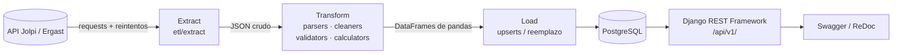

🌐 [English](README.md) · **Español**

# F1 ETL & Analytics API

[](https://github.com/Mrcipo/f1-etl-api/actions/workflows/ci.yml)


[](LICENSE)

Pipeline **Extract → Transform → Load** para datos de Fórmula 1. Descarga temporadas de la
[API pública Jolpi/Ergast](https://github.com/jolpica/jolpica-f1), las limpia y calcula métricas por
temporada con pandas, guarda todo en PostgreSQL y lo expone mediante una API REST de solo lectura hecha
con Django REST Framework.

## Arquitectura



| Capa | Qué hace |
|------|----------|
| `etl/extract` | Cliente HTTP con backoff exponencial; descarga carreras, resultados, clasificación y posiciones por temporada. Puede guardar el JSON crudo en `data/raw/`. |
| `etl/transform` | Convierte el JSON en DataFrames, normaliza tipos (los abandonos quedan con posición nula), valida columnas obligatorias y calcula métricas de pilotos y constructores (victorias, podios, poles, abandonos, posiciones ganadas, consistencia, dobletes, confiabilidad). |
| `etl/load` | Hace upsert de pilotos, constructores, circuitos y carreras; reemplaza resultados, clasificación, posiciones y métricas por carrera/temporada, así que volver a cargar una temporada no genera duplicados. |
| `etl/orchestrator.py` | Ejecuta las tres fases por temporada y registra cada corrida en la tabla `ETLRun` (`SUCCESS`, `PARTIAL` o `FAILED`). |
| `core/` | Modelos, serializers y vistas de solo lectura de Django. |

## Inicio rápido

Requisitos: Python 3.12+ y PostgreSQL (local o con Docker).

```bash
git clone https://github.com/Mrcipo/f1-etl-api.git
cd f1-etl-api
python -m venv venv
source venv/bin/activate        # Windows: venv\Scripts\activate
pip install -r requirements.txt

cp .env.example .env            # completar DB_PASSWORD y DJANGO_SECRET_KEY
docker compose up -d db         # opcional: PostgreSQL 16 con los valores de .env

python manage.py migrate
python manage.py run_etl --mode season --seasons 2023
python manage.py runserver
```

La API queda en `http://127.0.0.1:8000/api/v1/`, con documentación interactiva en `/api/docs/`
(Swagger UI) y `/api/redoc/`.

## Ejecutar el ETL

```bash
python manage.py run_etl --mode season --seasons 2022 2023 2024   # temporadas específicas
python manage.py run_etl --mode backfill                          # START_SEASON..END_SEASON de etl/config.py (2010–2024)
python manage.py run_etl --mode incremental                       # vuelve a cargar END_SEASON
python check_and_run_etl.py                                       # solo corre si la API tiene una carrera más nueva que la base
```

> **Nota:** el modo `incremental` hoy reprocesa la temporada definida en `END_SEASON`
> (`etl/config.py`), no la temporada en curso. `check_and_run_etl.py` compara la última carrera de la
> base con la última carrera completada en la API antes de lanzar el ETL, por lo que es la mejor opción
> para una tarea programada (cron, Programador de tareas).

## Endpoints

Todos los endpoints son de solo lectura (`GET`) y paginados (50 elementos por página).

| Endpoint | Descripción |
|----------|-------------|
| `/api/v1/drivers/` | Pilotos |
| `/api/v1/constructors/` | Constructores |
| `/api/v1/circuits/` | Circuitos |
| `/api/v1/races/` | Carreras (`/races/{id}/complete/` devuelve resultados, clasificación y posiciones en una sola respuesta) |
| `/api/v1/results/` | Resultados de carrera |
| `/api/v1/qualifying/` | Resultados de clasificación |
| `/api/v1/metrics/drivers/` | Métricas de pilotos por temporada |
| `/api/v1/metrics/constructors/` | Métricas de constructores por temporada |
| `/api/v1/standings/drivers/?season=2023` | Campeonato de pilotos (última fecha, o `&round=N`) |
| `/api/v1/standings/constructors/?season=2023` | Campeonato de constructores |
| `/api/v1/analytics/compare/drivers/?driver_ids=a,b&season=2023` | Comparación entre pilotos |

## Tests

```bash
pytest
```

La suite cubre parsers, cleaners, validators y calculadores de métricas, más un test end-to-end que corre
el pipeline completo contra un cliente Ergast simulado (sin red), carga en PostgreSQL, verifica que una
segunda corrida sea idempotente y consulta los endpoints REST. Necesita un PostgreSQL accesible
configurado en `.env`; en CI corre contra un contenedor de servicio `postgres:16`.

## Estructura del proyecto

```
f1-etl-api/
├── core/                 # App Django: modelos, serializers, vistas, admin, comando run_etl
├── etl/
│   ├── extract/          # Cliente Ergast, reintentos, extractores
│   ├── transform/        # parsers, cleaners, validators, calculators
│   ├── load/             # upserts y operaciones bulk
│   ├── orchestrator.py   # coordinación del pipeline + registro en ETLRun
│   └── config.py         # rango de temporadas, reintentos
├── f1api/                # settings y URLs del proyecto Django
├── tests/                # suite de pytest con fixtures sintéticos de la API
├── check_and_run_etl.py  # helper "correr solo si hay carrera nueva"
└── docker-compose.yml    # PostgreSQL 16 para desarrollo local
```

## Licencia

Publicado bajo la [Licencia MIT](LICENSE). Los datos provienen de la API Jolpi/Ergast; revisá sus
términos antes de redistribuirlos.
