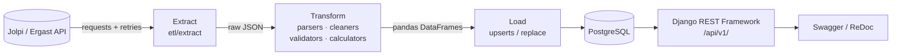

🌐 **English** · [Español](README.es.md)

# F1 ETL & Analytics API

[](https://github.com/Mrcipo/f1-etl-api/actions/workflows/ci.yml)


[](LICENSE)

An **Extract → Transform → Load** pipeline for Formula 1 data. It pulls seasons from the public
[Jolpi/Ergast API](https://github.com/jolpica/jolpica-f1), cleans them and computes per-season metrics
with pandas, stores everything in PostgreSQL and serves it through a read-only REST API built with
Django REST Framework.

## Architecture



| Layer | What it does |
|-------|--------------|
| `etl/extract` | HTTP client with exponential backoff; fetches races, results, qualifying and standings per season. Can save the raw JSON to `data/raw/`. |
| `etl/transform` | Parses JSON into DataFrames, normalises types (DNFs keep a null position), validates required columns and computes driver/constructor metrics (wins, podiums, poles, DNFs, positions gained, consistency, one-two finishes, reliability). |
| `etl/load` | Upserts drivers, constructors, circuits and races; replaces results, qualifying, standings and metrics per race/season, so re-running a season does not create duplicates. |
| `etl/orchestrator.py` | Runs the three phases per season and records each run in the `ETLRun` table (`SUCCESS`, `PARTIAL` or `FAILED`). |
| `core/` | Django models, serializers and read-only views. |

## Quick start

Requirements: Python 3.12+ and PostgreSQL (local or via Docker).

```bash
git clone https://github.com/Mrcipo/f1-etl-api.git
cd f1-etl-api
python -m venv venv
source venv/bin/activate        # Windows: venv\Scripts\activate
pip install -r requirements.txt

cp .env.example .env            # then set DB_PASSWORD and DJANGO_SECRET_KEY
docker compose up -d db         # optional: PostgreSQL 16 using the values in .env

python manage.py migrate
python manage.py run_etl --mode season --seasons 2023
python manage.py runserver
```

The API is then available at `http://127.0.0.1:8000/api/v1/`, with interactive docs at
`/api/docs/` (Swagger UI) and `/api/redoc/`.

## Running the ETL

```bash
python manage.py run_etl --mode season --seasons 2022 2023 2024   # specific seasons
python manage.py run_etl --mode backfill                          # START_SEASON..END_SEASON from etl/config.py (2010–2024)
python manage.py run_etl --mode incremental                       # re-loads END_SEASON
python check_and_run_etl.py                                       # only runs if the API has a newer race than the DB
```

> **Note:** `incremental` mode currently re-processes the season set in `END_SEASON`
> (`etl/config.py`), not the live current season. `check_and_run_etl.py` compares the last race in the
> database with the API's last completed race before triggering a run, which makes it the better
> option for a scheduled job (cron, Task Scheduler).

## API endpoints

All endpoints are read-only (`GET`) and paginated (50 items per page).

| Endpoint | Description |
|----------|-------------|
| `/api/v1/drivers/` | Drivers |
| `/api/v1/constructors/` | Constructors |
| `/api/v1/circuits/` | Circuits |
| `/api/v1/races/` | Races (`/races/{id}/complete/` returns results, qualifying and standings in one response) |
| `/api/v1/results/` | Race results |
| `/api/v1/qualifying/` | Qualifying results |
| `/api/v1/metrics/drivers/` | Per-season driver metrics |
| `/api/v1/metrics/constructors/` | Per-season constructor metrics |
| `/api/v1/standings/drivers/?season=2023` | Driver standings (latest round, or `&round=N`) |
| `/api/v1/standings/constructors/?season=2023` | Constructor standings |
| `/api/v1/analytics/compare/drivers/?driver_ids=a,b&season=2023` | Side-by-side driver comparison |

## Tests

```bash
pytest
```

The suite covers the parsers, cleaners, validators and metric calculators, plus an end-to-end test that
runs the full pipeline against a fake Ergast client (no network), loads into PostgreSQL, checks that a
second run is idempotent and queries the REST endpoints. It needs a reachable PostgreSQL configured
through `.env`; CI runs it against a `postgres:16` service container.

## Project structure

```
f1-etl-api/
├── core/                 # Django app: models, serializers, views, admin, run_etl command
├── etl/
│   ├── extract/          # Ergast client, retries, extractors
│   ├── transform/        # parsers, cleaners, validators, calculators
│   ├── load/             # upserts and bulk operations
│   ├── orchestrator.py   # pipeline coordination + ETLRun tracking
│   └── config.py         # season range, retry settings
├── f1api/                # Django project settings and URLs
├── tests/                # pytest suite with synthetic API fixtures
├── check_and_run_etl.py  # "only run if there is a new race" helper
└── docker-compose.yml    # PostgreSQL 16 for local development
```

## License

Released under the [MIT License](LICENSE). Data comes from the Jolpi/Ergast API; check its terms before
redistributing it.
